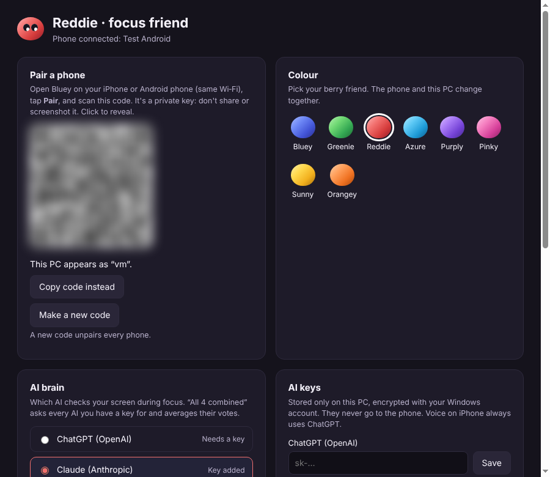

# Bluey by Riley and Treat

A little berry focus friend who lives on your phone, sits under your computer screen, watches your screen with AI while you focus, and gives you a gentle nudge when you drift off task.

This is [rbrown101010/bluey-by-riley](https://github.com/rbrown101010/bluey-by-riley) with three big additions:

1. **Colours.** Pick your friend: **Bluey**, **Greenie**, **Reddie**, **Azure**, **Purply**, **Pinky**, **Sunny** or **Orangey**. Change it on the computer or the phone and both change together.
2. **Any computer, any phone.** **Mac or Windows** on the computer, **iPhone or Android** on the phone, in any combination.
3. **Choose the AI.** In the settings menu, pick **ChatGPT**, **Claude**, **Gemini**, **DeepSeek**, or **All 4 combined**, where every AI you have a key for votes and Bluey averages the answers.


## Which apps to use

| | iPhone | Android |
|---|---|---|
| **Mac** | `Mac/` + `iOS/` | `Mac/` + `android/` |
| **Windows** | `windows/` + `iOS/` | `windows/` + `android/` |

Everything pairs the same way: open Bluey on the computer, open Bluey on the phone (same Wi‑Fi), tap **Pair**, and scan the QR code.

## Getting the apps

### Windows

Each push to GitHub builds a Windows installer: open the **Actions** tab, pick the latest **Build and test** run and download **Bluey-Windows**. It contains `Bluey Setup 0.2.0.exe` (installer) and `Bluey 0.2.0.exe` (portable, no install needed).

To run it from the source code instead, install [Node.js](https://nodejs.org) 22 or newer, then:

```sh
cd windows
npm install
npm start
```

Bluey appears in the system tray (bottom right, by the clock). Click it to open **Settings**:



- **Pair a phone**: click the blurred code to show it, then scan it with the phone. On Android you can also use **Copy code instead** and paste it into the phone.
- **Colour**: pick your berry.
- **AI brain**: ChatGPT, Claude, Gemini, DeepSeek or All 4 combined.
- **AI keys**: paste a key for each AI you want to use. Keys are encrypted with your Windows account and never go to the phone.
- **Focus**: start, pause and end sessions, Developer Mode, and your recent timelines.

A small berry sits in the bottom-right corner of the screen with the countdown and speech bubbles. You can hide it in Settings or from the tray menu.

### Android

**Actions** → latest **Build and test** run → download **Bluey-Android** and install the `.apk` (Android 8 or newer; allow installing from your browser or file manager when asked).

To build it yourself, open the `android` folder in Android Studio and press **Run**, or run `./gradlew :app:assembleDebug`.

Turn the phone sideways under your screen. **Hold the face** and say what you're working on, like “maths homework for 45 minutes”, and let go. Saying “pause”, “resume” or “stop” controls a running session. Tap **☰** (or double-tap the face) for colours, the AI brain, pairing, typing a task, Developer Mode and your history.

### Mac and iPhone

These are the original apps, now with colours and the AI picker. Build them as before (see [the Mac and iPhone guide](docs/mac-and-iphone.md)):

```sh
./scripts/build-mac.sh && open build/Bluey.app --args --pair
xcodegen generate   # then build the GooglyEyes scheme to your iPhone in Xcode
```

On the Mac, everything is in Bluey's menu bar menu: **Colour**, **AI Brain** and **AI Keys**. On the iPhone, the colour swatches and AI brain picker are at the top of the **Focus** sheet.

## Choosing the AI

| Choice | What it uses | Key from |
|---|---|---|
| ChatGPT | OpenAI's Decisions API with the screenshot and screen text | [platform.openai.com](https://platform.openai.com/api-keys) |
| Claude | Claude Opus 5.5 with the screenshot and screen text | [console.anthropic.com](https://console.anthropic.com/settings/keys) |
| Gemini | Gemini Flash (latest) with the screenshot and screen text | [aistudio.google.com](https://aistudio.google.com/apikey) |
| DeepSeek | DeepSeek chat. It reads **text only**: the screen text on Mac, or the window title on Windows | [platform.deepseek.com](https://platform.deepseek.com/api_keys) |
| All 4 combined | Asks every AI you have a key for at the same time, averages their on-task, off-task and unsure estimates, and goes with the strongest | Any of the above (you don't need all four) |

- Model names can be changed: on Windows under **Settings → AI keys → Model names**; on Mac with `defaults write co.visionairy.googly.mac claudeModel <name>` (also `geminiModel`, `deepseekModel`).
- Nudge wording comes from the AI you picked. With All 4 combined, it comes from the first one that has a key.
- **Voice on iPhone always uses ChatGPT** (OpenAI Realtime), so add an OpenAI key if you want to talk to Bluey on an iPhone. Android uses the phone's own speech recognition instead and doesn't need any key for voice.

## Privacy

While a focus session runs, the computer sends a screenshot of its main screen to the AI you picked every 30 seconds (every 10 in Developer Mode), with the task, the time so far, and the last few results. With All 4 combined, it goes to every AI you have a key for. Bluey doesn't save screenshots. Locking the computer, closing the phone app or disconnecting pauses everything, and resuming is always manual. Each AI company's own data rules apply to your API account.

The phone and computer pair with a private QR code and encrypt everything they send each other (details in [docs/PROTOCOL.md](docs/PROTOCOL.md)). API keys stay on the computer.

## What's different on each computer

| | Mac | Windows |
|---|---|---|
| Focus sessions, nudges and timelines | ✓ | ✓ |
| Colours, AI brain, AI keys | ✓ | ✓ |
| Phone's eyes follow your mouse | ✓ | ✓ |
| Talk to Bluey from an iPhone | ✓ | ✓ (focus commands only) |
| Desktop character | Big cursor that points at things | Small berry in the corner |
| Reads small screen text (OCR) | ✓ | Window title only |
| Points at things, clicks and types for you, Codex, meeting notes | ✓ | Not yet |

## Tests

```sh
cd windows && npm test                         # Windows: link, focus engine, all 4 AIs (no real API calls)
cd android && ./gradlew :core:test             # Android: encryption, pairing, focus snapshots, spoken tasks
swift test --scratch-path /tmp/bluey-swift      # Mac/iPhone shared code (on a Mac)
```

The Windows and Android tests run here and pass, and a simulated Android phone was paired with the Windows app end to end over the network (discovery, encrypted pairing, colour sync, starting focus, voice tools). The **Build and test** GitHub Action builds all four apps on real Windows, Linux and macOS machines. The Swift changes and the Android screens couldn't be compiled in the environment these changes were made in, so check that first Action run before relying on them.

## Layout

- `Shared/`: Mac and iPhone code shared by both (secure link, colours, AI choice, focus rules).
- `Mac/`: Mac menu bar app. `iOS/`: iPhone app.
- `windows/`: Windows tray app (Electron). `android/`: Android app (`core/` is plain Kotlin and tested on any computer, `app/` is the Android UI).
- `docs/`: the protocol, the original Mac and iPhone guide, and pictures.

## License

Public domain under [the Unlicense](LICENSE), like the original. Do whatever you want with it.
